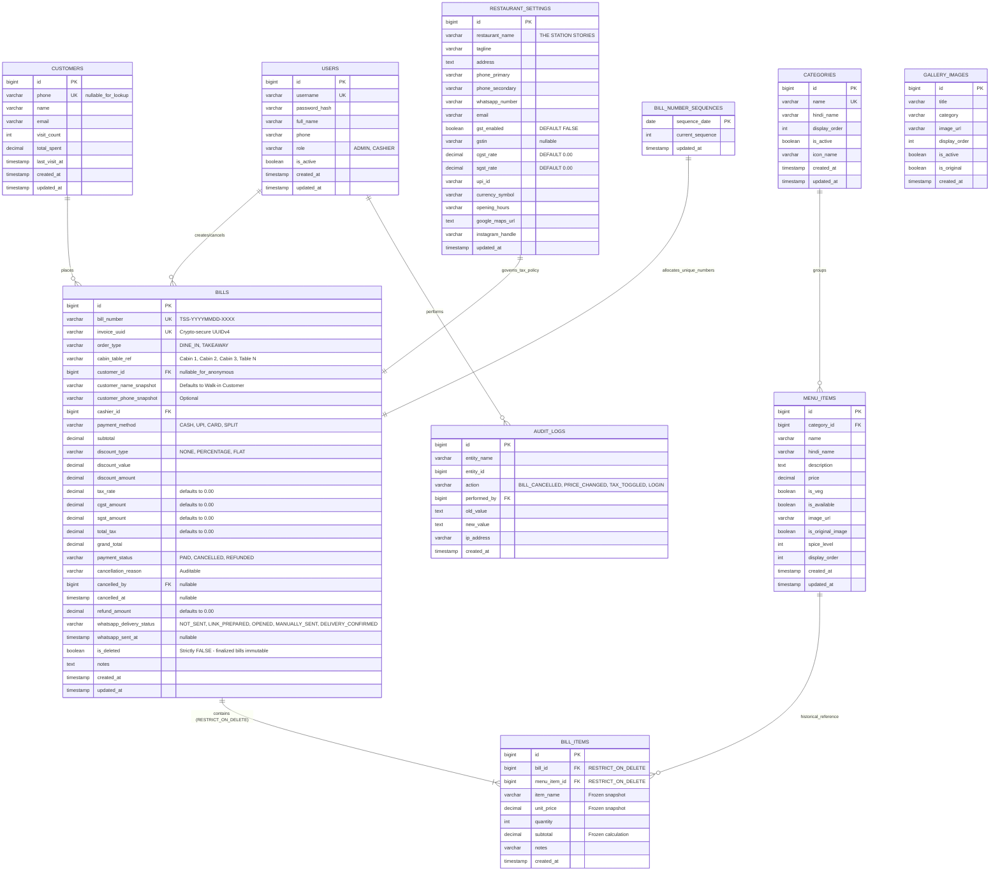

# THE STATION STORIES – Database Design & Schema Specification

## 1. Entity-Relationship (ER) Diagram



---

## 2. Table Specifications & Financial Data Safety Rules

### Database Name
**`the_station_stories`** (MySQL 8 with `utf8mb4` encoding and `utf8mb4_unicode_ci` collation).

---

### Table: `bill_number_sequences`
Ensures thread-safe, gap-free, unique bill serial numbers even during peak concurrent billing.

```sql
CREATE TABLE bill_number_sequences (
    sequence_date DATE NOT NULL PRIMARY KEY,
    current_sequence INT NOT NULL DEFAULT 0,
    updated_at TIMESTAMP NOT NULL DEFAULT CURRENT_TIMESTAMP ON UPDATE CURRENT_TIMESTAMP
) ENGINE=InnoDB DEFAULT CHARSET=utf8mb4 COLLATE=utf8mb4_unicode_ci;
```

**Concurrency Protocol**:
When generating a new bill, the backend transaction executes:
```sql
SELECT current_sequence FROM bill_number_sequences WHERE sequence_date = CURRENT_DATE() FOR UPDATE;
```
If row exists, increment and update; if not, insert with `current_sequence = 1`. This row-level lock ensures sequential bill numbers like `TSS-20261112-0001` without race conditions or duplicates.

---

### Table: `bills`
Permanent, immutable sales ledger. Finalized bills can **never** be deleted.

| Column | Type | Constraints | Default | Description |
|---|---|---|---|---|
| `id` | BIGINT | PRIMARY KEY, AUTO_INCREMENT | - | Internal identifier |
| `bill_number` | VARCHAR(50) | NOT NULL, UNIQUE | - | e.g., `TSS-20261112-0001` |
| `invoice_uuid` | VARCHAR(64) | NOT NULL, UNIQUE | - | Cryptographically secure random UUIDv4 for public access |
| `order_type` | VARCHAR(20) | NOT NULL | 'DINE_IN' | `DINE_IN`, `TAKEAWAY` |
| `cabin_table_ref` | VARCHAR(50) | NULL | NULL | Assigned table or private cabin (`Cabin 1`, `Cabin 2`, `Cabin 3`) |
| `customer_id` | BIGINT | NULL, FK(`customers.id` ON DELETE SET NULL) | NULL | Linked customer record (NULL for anonymous walk-ins) |
| `customer_name_snapshot` | VARCHAR(100) | NOT NULL | 'Walk-in Customer' | Captured customer name at billing time |
| `customer_phone_snapshot` | VARCHAR(15) | NULL | NULL | Captured mobile number (optional; never forced) |
| `cashier_id` | BIGINT | NOT NULL, FK(`users.id` ON DELETE RESTRICT) | - | Staff account who executed the bill |
| `payment_method` | VARCHAR(20) | NOT NULL | 'CASH' | `CASH`, `UPI`, `CARD`, `SPLIT` |
| `subtotal` | DECIMAL(10,2) | NOT NULL | - | Authoritative backend sum of line items |
| `discount_type` | VARCHAR(20) | NOT NULL | 'NONE' | `NONE`, `PERCENTAGE`, `FLAT` |
| `discount_value` | DECIMAL(10,2) | NOT NULL | 0.00 | Input discount value (% or ₹) |
| `discount_amount` | DECIMAL(10,2) | NOT NULL | 0.00 | Computed discount in INR |
| `tax_rate` | DECIMAL(5,2) | NOT NULL | 0.00 | Tax percentage (**strictly 0.00% when disabled**) |
| `cgst_amount` | DECIMAL(10,2) | NOT NULL | 0.00 | Central GST (**0.00 when disabled**) |
| `sgst_amount` | DECIMAL(10,2) | NOT NULL | 0.00 | State GST (**0.00 when disabled**) |
| `total_tax` | DECIMAL(10,2) | NOT NULL | 0.00 | Sum of CGST and SGST |
| `grand_total` | DECIMAL(10,2) | NOT NULL | - | Authoritative payable total: `ROUND(subtotal - discount + tax)` |
| `payment_status` | VARCHAR(20) | NOT NULL | 'PAID' | `PAID`, `CANCELLED`, `REFUNDED` |
| `cancellation_reason` | VARCHAR(255) | NULL | NULL | Mandatory reason logged upon cancellation |
| `cancelled_by` | BIGINT | NULL, FK(`users.id` ON DELETE RESTRICT) | NULL | Manager/Admin who authorized cancellation |
| `cancelled_at` | TIMESTAMP | NULL | NULL | Timestamp of cancellation |
| `refund_amount` | DECIMAL(10,2) | NOT NULL | 0.00 | Total refund issued |
| `whatsapp_delivery_status` | VARCHAR(30) | NOT NULL | 'NOT_SENT' | `NOT_SENT`, `LINK_PREPARED`, `OPENED`, `MANUALLY_SENT`, `DELIVERY_CONFIRMED` |
| `whatsapp_sent_at` | TIMESTAMP | NULL | NULL | Timestamp of manual dispatch or API confirmation |
| `is_deleted` | BOOLEAN | NOT NULL | FALSE | Safety flag; service layer strictly prevents hard deletes |
| `notes` | TEXT | NULL | NULL | Special preparation or counter instructions |
| `created_at` | TIMESTAMP | NOT NULL | CURRENT_TIMESTAMP | Transaction creation timestamp |
| `updated_at` | TIMESTAMP | NOT NULL | CURRENT_TIMESTAMP ON UPDATE CURRENT_TIMESTAMP | Audit modification timestamp |

---

### Table: `bill_items`
Frozen item snapshot. **Cascading delete is strictly disabled (`ON DELETE RESTRICT`)**.

| Column | Type | Constraints | Default | Description |
|---|---|---|---|---|
| `id` | BIGINT | PRIMARY KEY, AUTO_INCREMENT | - | Unique line item record |
| `bill_id` | BIGINT | NOT NULL, FK(`bills.id` ON DELETE RESTRICT) | - | Parent bill relationship |
| `menu_item_id` | BIGINT | NULL, FK(`menu_items.id` ON DELETE RESTRICT) | NULL | Original dish reference |
| `item_name` | VARCHAR(150) | NOT NULL | - | **Snapshot** of dish name at time of sale |
| `unit_price` | DECIMAL(10,2) | NOT NULL | - | **Snapshot** of dish price at time of sale |
| `quantity` | INT | NOT NULL | 1 | Units purchased (minimum 1) |
| `subtotal` | DECIMAL(10,2) | NOT NULL | - | Authoritative line calculation: `unit_price * quantity` |
| `notes` | VARCHAR(255) | NULL | NULL | Customization note (e.g., "Extra spicy") |
| `created_at` | TIMESTAMP | NOT NULL | CURRENT_TIMESTAMP | Creation timestamp |

> [!IMPORTANT]
> **Immutability Guarantee**: Even if the restaurant owner alters a dish price in `menu_items` from ₹120 to ₹150, the `bill_items` table retains the original `unit_price = 120.00` and `subtotal` indefinitely. Historical invoices are never altered by catalog updates.

---

### Table: `customers`
Customer directory supporting seamless anonymous checkout and returning customer tracking.

| Column | Type | Constraints | Default | Description |
|---|---|---|---|---|
| `id` | BIGINT | PRIMARY KEY, AUTO_INCREMENT | - | Customer record ID |
| `phone` | VARCHAR(15) | NOT NULL, UNIQUE | - | 10-digit mobile number (lookup key) |
| `name` | VARCHAR(100) | NULL | NULL | Customer full name |
| `email` | VARCHAR(120) | NULL | NULL | Customer email |
| `visit_count` | INT | NOT NULL | 1 | Cumulative recorded visits |
| `total_spent` | DECIMAL(12,2) | NOT NULL | 0.00 | Lifetime revenue generated |
| `last_visit_at` | TIMESTAMP | NOT NULL | CURRENT_TIMESTAMP | Most recent purchase |
| `created_at` | TIMESTAMP | NOT NULL | CURRENT_TIMESTAMP | Registration timestamp |
| `updated_at` | TIMESTAMP | NOT NULL | CURRENT_TIMESTAMP ON UPDATE CURRENT_TIMESTAMP | Profile update timestamp |

**Walk-in / Anonymous Policy**:
- Providing customer phone is completely **optional**.
- If a customer prefers anonymity, `customer_id` is saved as `NULL` on the bill, and `customer_name_snapshot` is stored as `'Walk-in Customer'`.
- If a 10-digit phone number is provided, the backend queries `customers` by phone:
  - If existing: links `customer_id`, increments `visit_count`, and adds `grand_total` to `total_spent`.
  - If new: creates a new customer record and links `customer_id`.
  - This avoids duplicate records while rewarding customer loyalty.

---

### Table: `audit_logs`
Immutable security and compliance event log.

| Column | Type | Constraints | Default | Description |
|---|---|---|---|---|
| `id` | BIGINT | PRIMARY KEY, AUTO_INCREMENT | - | Audit event ID |
| `entity_name` | VARCHAR(50) | NOT NULL | - | `BILL`, `SETTING`, `MENU_ITEM`, `USER` |
| `entity_id` | BIGINT | NOT NULL | - | Target record primary key |
| `action` | VARCHAR(50) | NOT NULL | - | `BILL_CANCELLED`, `REFUND_ISSUED`, `PRICE_UPDATED`, `TAX_POLICY_CHANGED`, `LOGIN_FAILED` |
| `performed_by` | BIGINT | NULL, FK(`users.id` ON DELETE SET NULL) | NULL | User responsible |
| `old_value` | JSON | NULL | NULL | Pre-change state |
| `new_value` | JSON | NULL | NULL | Post-change state |
| `ip_address` | VARCHAR(45) | NULL | NULL | Client IP |
| `created_at` | TIMESTAMP | NOT NULL | CURRENT_TIMESTAMP | Audit timestamp |

---

### Table: `restaurant_settings`
Singleton table holding verified restaurant parameters and flexible tax settings.

| Column | Type | Constraints | Default | Description |
|---|---|---|---|---|
| `id` | BIGINT | PRIMARY KEY | 1 | Singleton row |
| `restaurant_name` | VARCHAR(150) | NOT NULL | 'THE STATION STORIES' | Official brand name |
| `tagline` | VARCHAR(255) | NULL | 'Fast Food & Restaurant' | Brand subtitle |
| `address` | TEXT | NOT NULL | '[Pending Owner Confirmation - Placeholder Address]' | Street address |
| `phone_primary` | VARCHAR(20) | NOT NULL | '[Pending Owner Confirmation]' | Primary phone |
| `phone_secondary` | VARCHAR(20) | NULL | NULL | Secondary contact |
| `whatsapp_number` | VARCHAR(20) | NOT NULL | '[Pending Owner Confirmation]' | WhatsApp bill sender |
| `email` | VARCHAR(120) | NULL | NULL | Inquiry email |
| `gst_enabled` | BOOLEAN | NOT NULL | FALSE | **STRICTLY FALSE BY DEFAULT** |
| `gstin` | VARCHAR(25) | NULL | NULL | GSTIN (NULL until verified) |
| `cgst_rate` | DECIMAL(5,2) | NOT NULL | 0.00 | CGST % (0.00 default) |
| `sgst_rate` | DECIMAL(5,2) | NOT NULL | 0.00 | SGST % (0.00 default) |
| `upi_id` | VARCHAR(100) | NULL | NULL | UPI VPA for printed QR |
| `currency_symbol` | VARCHAR(10) | NOT NULL | '₹' | INR currency symbol |
| `opening_hours` | VARCHAR(100) | NOT NULL | '[Pending Owner Confirmation]' | Daily timings |
| `google_maps_url` | TEXT | NULL | NULL | Google Maps link |
| `instagram_handle`| VARCHAR(100) | NULL | NULL | Instagram profile |
| `updated_at` | TIMESTAMP | NOT NULL | CURRENT_TIMESTAMP ON UPDATE CURRENT_TIMESTAMP | Settings update |

---

## 3. High-Performance Indexing Strategy

```sql
-- Fast POS customer lookup by 10-digit mobile number
CREATE INDEX idx_customers_phone ON customers(phone);

-- Financial reporting & analytics
CREATE INDEX idx_bills_created_at ON bills(created_at);
CREATE INDEX idx_bills_payment_status ON bills(payment_status);
CREATE INDEX idx_bills_payment_method ON bills(payment_method);
CREATE INDEX idx_bills_bill_number ON bills(bill_number);
CREATE INDEX idx_bills_invoice_uuid ON bills(invoice_uuid);

-- Line item queries
CREATE INDEX idx_bill_items_bill_id ON bill_items(bill_id);
CREATE INDEX idx_bill_items_menu_item_id ON bill_items(menu_item_id);

-- Menu and category navigation
CREATE INDEX idx_menu_items_category_id ON menu_items(category_id);
CREATE INDEX idx_menu_items_is_available ON menu_items(is_available);
CREATE INDEX idx_categories_display_order ON categories(display_order);

-- Security and audit tracking
CREATE INDEX idx_audit_logs_entity ON audit_logs(entity_name, entity_id);
CREATE INDEX idx_audit_logs_action ON audit_logs(action);
```

---

## 4. Flyway Database Migration Plan

1. **`V1__init_schema.sql`**:
   - Creates `users`, `categories`, `menu_items`, `customers`, `bill_number_sequences`, `bills`, `bill_items`, `audit_logs`, `restaurant_settings`, and `gallery_images`.
   - Enforces `ON DELETE RESTRICT` on all financial relationships.
   - Sets up performance indexes.
2. **`V2__seed_initial_data.sql`**:
   - Seeds default `restaurant_settings` with `restaurant_name = 'THE STATION STORIES'`, `gst_enabled = FALSE`, and clearly marked placeholders for unconfirmed fields.
   - Seeds menu categories (`Burgers & Sandwiches`, `Pizzas & Garlic Breads`, `Chinese & Fast Food`, `Beverages & Shakes`, `Chaat & Quick Bites`).
   - Seeds temporary menu items referencing `frontend/public/images/food/` with `is_original_image = FALSE`.
   - Seeds the 13 authentic photographs referencing `frontend/public/images/restaurant/` with `is_original = TRUE`.
   - Seeds the initial `bill_number_sequences` tracker.
