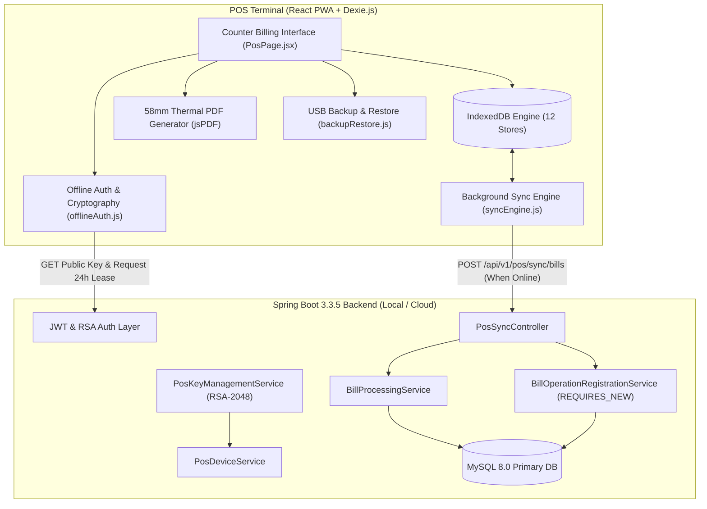
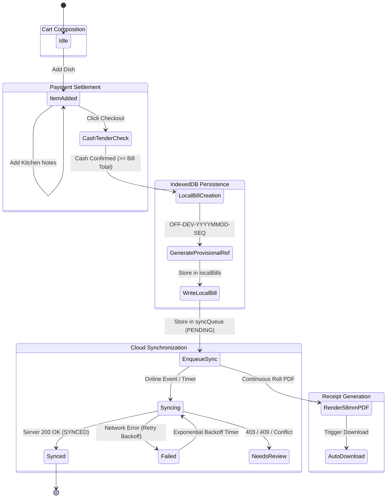

# THE STATION STORIES — OFFLINE-FIRST POS ARCHITECTURE SPECIFICATION

**Document Version**: 1.0.0  
**Target Systems**: POS Counter Terminals (Desktop Chrome / Safari / Edge PWA)  
**Security Level**: Enterprise Retail Cryptographic Integrity  

---

## 1. Architectural Overview

The Station Stories POS terminal is designed around an **Offline-First Reactive Architecture**. The client browser maintains complete local data independence, enabling full billing and receipt generation capabilities even during total cloud or network outages.



---

## 2. Cryptographic Security Model

### 2.1 Asymmetric Offline Lease Token (RSA-2048)
To prevent unauthorized offline billing on untrusted devices, all offline counter operations require a cryptographically signed **Offline Lease Token**:

```
+-------------------------------------------------------------------------+
|                              LEASE TOKEN                                |
|  Base64URL(Header) . Base64URL(Payload) . Base64URL(RSA-2048 Signature) |
+-------------------------------------------------------------------------+
```

1. **Token Generation (Backend Server)**:
   - Generated by `PosDeviceService.issueOfflineLease()`.
   - Payload contains:
     ```json
     {
       "leaseId": "LEASE-1731490000000",
       "deviceId": "DEV-410F375D",
       "cashierId": 5,
       "cashierUsername": "cashier_ramesh",
       "issuedAt": "2026-11-13T10:00:00Z",
       "expiresAt": "2026-11-14T10:00:00Z"
     }
     ```
   - Signed using SHA256withRSA with the server's private RSA-2048 key. The private key never leaves the backend.
2. **Offline Verification (Browser Terminal)**:
   - Verified by `verifyOfflineLease()` in `offlineAuth.js`.
   - Uses Web Crypto API: `crypto.subtle.verify('RSASSA-PKCS1-v1_5', ...)`.
   - Validates that:
     - The signature matches the server's cached SPKI public key.
     - `Date.now() < expiresAt` (strict 24-hour validity window).
     - `deviceId` matches the terminal's registered hardware ID.
     - `cashierId` matches the currently active cashier session.

### 2.2 Cashier Security PIN (PBKDF2-SHA256)
- **Algorithm**: PBKDF2 with HMAC-SHA256.
- **Iterations**: 100,000.
- **Salt**: 16 cryptographically secure random bytes generated via `crypto.getRandomValues()`.
- **Derived Output**: 256 bits (32 bytes), stored as a 64-character hex string.
- **Storage**: Persisted strictly in IndexedDB (`offlineAuthorization.cashier_pin`). No raw PINs are stored in plaintext.

---

## 3. Data Flow & Transaction State Machine



### 3.1 Provisional Reference Structure
Every offline bill is immediately assigned a deterministic, human-readable provisional reference:
$$\text{REF} = \text{OFF} - \text{DeviceShortId} - \text{YYYYMMDD} - \text{Sequence}$$
- Example: `OFF-AL01-20261113-0001`
- **DeviceShortId**: Last 4 alphanumeric characters of the registered device ID.
- **Date**: UTC billing date string (`YYYYMMDD`).
- **Sequence**: 4-digit zero-padded local sequence counter for that device on that date.

---

## 4. IndexedDB 12-Store Schema Strategy

| Store Name | Primary Key | Key Indexes | Purpose |
| :--- | :--- | :--- | :--- |
| `categories` | `id` | `displayOrder`, `active` | Cached categories for instant UI catalog rendering |
| `menuItems` | `id` | `categoryId`, `price`, `veg`, `available` | Authoritative local menu cache with veg/non-veg tags |
| `customers` | `id` | `phone`, `name` | Customer lookup & loyalty points cache |
| `localBills` | `id` (autoincrement) | `clientUuid`, `localReference`, `status`, `syncStatus` | Complete local billing records |
| `localBillItems` | `id` (autoincrement) | `localBillId`, `clientUuid`, `menuItemId` | Immutable item snapshots at time of billing |
| `syncQueue` | `id` (autoincrement) | `clientUuid`, `status`, `nextRetryAt` | Durable FIFO background synchronization queue |
| `operationRecords` | `operationKey` | `status`, `clientUuid`, `createdAt` | Idempotency locks preventing duplicate local operations |
| `deviceRegistration`| `deviceId` | `deviceName`, `isRevoked` | Trusted device hardware identity and status |
| `offlineAuthorization`| `cashierId` | `deviceId`, `expiresAt` | 24-hour lease token, public key, and PBKDF2 PIN hashes |
| `appSettings` | `key` | `updatedAt` | Terminal configuration and cached RSA public key |
| `backupMetadata` | `id` (autoincrement) | `filename`, `checksum`, `createdAt` | Audit history of exports and imports |
| `syncMetadata` | `key` | `lastSyncAt` | Last sync high-water mark and failure counters |

---

## 5. Synchronization Protocol & Conflict Resolution

### 5.1 Synchronization Payload
The background sync engine submits each pending record to `POST /api/v1/pos/sync/bills` as a `SyncBillRequest`:
```json
{
  "localBillReference": "OFF-AL01-20261113-0001",
  "deviceId": "DEV-410F375D",
  "billRequest": {
    "orderType": "DINE_IN",
    "cabinTableRef": "Table 4",
    "customerPhone": "9876543210",
    "customerName": "Ramesh Gupta",
    "paymentMethod": "CASH",
    "discountType": "NONE",
    "discountValue": 0,
    "localBillReference": "OFF-AL01-20261113-0001",
    "deviceId": "DEV-410F375D",
    "isOfflineCreated": true,
    "items": [
      {
        "menuItemId": 12,
        "quantity": 2,
        "unitPriceSnapshot": 180.00,
        "notes": "Extra spicy"
      }
    ]
  }
}
```

### 5.2 Server Idempotency & Reconciliation Logic
1. **Deduplication**: The backend queries `bills.local_bill_reference`. If a record already exists, it immediately responds with `status: "ALREADY_SYNCED"`, preserving the existing `serverBillId` and `serverBillNumber` without generating a second bill.
2. **Pricing Snapshots**: The backend honors the `unitPriceSnapshot` recorded at the time of offline sale, ensuring historical sales figures remain faithful to what the customer paid.
3. **Transaction State Mapping**:
   - `SYNCED`: Successfully created and committed to MySQL. The client updates `localBills` with `serverBillId` and `serverBillNumber`.
   - `ALREADY_SYNCED`: Idempotent match; client marks as synced.
   - `NEEDS_REVIEW`: Returned if the device has been revoked or data conflicts require managerial oversight.
   - Network failure: Client queues for retry with exponential backoff and jitter.
