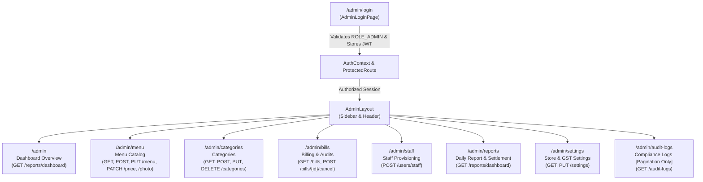
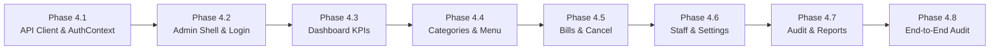

# PHASE 4 – SECURE ADMIN DASHBOARD: ARCHITECTURE & IMPLEMENTATION PLAN
**Project:** The Station Stories – Restaurant Management Platform  
**Target Release:** Phase 4 (Secure Admin Dashboard)  
**Document Version:** 1.1.0 (Planning Reconciled with Backend API Reality)  
**Status:** Approved for Phase 4.1 Implementation  
**Date:** November 2026  

---

## 1. Executive Summary & Context

Phase 4 delivers the **Secure Admin Dashboard** for **The Station Stories**, providing restaurant management with administrative control over menu engineering, real-time dish availability, billing oversight, non-destructive invoice cancellation, staff provisioning, dynamic GST and store settings, and regulatory compliance audit inspection.

### 1.1 Strict Phase Boundaries & Architectural Invariants
1. **Reuse Existing Backend APIs**: Spring Boot 3.3.5 backend implementation already includes 37 verified controller handler mappings. Phase 4 consumes the 17 existing administrator controller mappings in `AdminController.java` and authentication endpoints in `AuthController.java` without modifying or rebuilding backend code.
2. **Design System Consistency**: The dashboard strictly adheres to the approved brand palette:
   - **Warm Ivory (`#F7F1E8`)**: Core page backgrounds, card interiors, and table surfaces.
   - **Royal Plum (`#45213F`)**: Primary navigation, active indicators, modal headers, brand typography.
   - **Champagne Gold (`#C5A16B`)**: Accent borders, metric icons, primary CTA buttons, premium trim.
   - **Dark Plum (`#32172F`)**: High-contrast sidebars and dark badge accents.
   - **Soft Lavender (`#E9DDEB`)**: Table headers, subtle secondary cards, and input backgrounds.
   - **Muted Rose (`#B88E9D`)**: Soft warning highlights and category chips.
   - **Body Text (`#332A35`)**: High-legibility typography across all data grids.
   *(The legacy charcoal theme `#121212` from initial Phase 1 placeholders is completely retired).*
3. **Application Separation**:
   - The **Public Customer Website** (Phase 3) remains completely separated and unaltered.
   - The **Local Offline POS Terminal** (Phase 5) is deferred to the next phase.
   - Cashiers authenticated with `ROLE_CASHIER` are strictly blocked from accessing `/admin/*` routes.
4. **Security & Zero-Trust Client Architecture**:
   - JWT tokens are passed via standard `Authorization: Bearer <token>` HTTP headers.
   - All admin routes are protected by client-side role guards (`ProtectedRoute`) verifying `ROLE_ADMIN`.
   - No database credentials, JWT secrets, or administrative passwords are hardcoded in frontend code.
   - React will never connect directly to MySQL; all data flows through Spring Boot REST endpoints.
   - **JWT Storage & Security Assessment**:
     - The frontend stores the issued JWT in `localStorage` (`tss_token`) for authorization headers across page reloads.
     - *XSS Security Trade-off*: While HTTP-only cookies are theoretically safer against cross-site scripting (XSS), backend cookie authentication cannot be introduced because Java backend changes and API contracts are strictly out of scope.
     - *Mitigations*: The frontend strictly avoids `dangerouslySetInnerHTML`, enforces clean React DOM escaping, ensures tokens are **never** logged to the browser console, **never** passed in URL query strings, and **never** exposed in UI error banners or toast notifications.

---

## 2. Frontend Structure & Routing Audit

### 2.1 Current Frontend Inventory
- **Build System**: Vite 5.4.10 + React 18.3.1 + Tailwind CSS 3.4.15.
- **Routing**: `react-router-dom` v6.28.0 configured in `src/routes/AppRoutes.jsx`.
- **Icons & Motion**: `lucide-react` v0.460.0, `framer-motion` v14.12.0.
- **Existing Phase 1 Admin Placeholders**:
  - `src/layouts/AdminLayout.jsx`: Legacy placeholder using retired charcoal colors; lacks authentication guards.
  - `src/pages/admin/AdminLoginPage.jsx`: Static mockup with disabled inputs; not connected to authentication APIs.
  - `src/pages/admin/AdminDashboardPage.jsx`: Static metric cards with mock data (`₹0.00`).
  - `src/contexts/` and `src/hooks/`: Directories exist and will house `AuthContext.jsx` and `useAuth.js`.

### 2.2 Reusable Frontend Assets
| Asset / Component | Location | Reusability in Phase 4 |
|---|---|---|
| `LoadingState.jsx` | `src/components/common/LoadingState.jsx` | 100% reusable for asynchronous data fetching across all admin views. |
| `EmptyState.jsx` | `src/components/common/EmptyState.jsx` | 100% reusable for empty search results, bills, or menu categories. |
| `BrandLogo.jsx` | `src/components/common/BrandLogo.jsx` | Reusable in admin sidebar and login page for luxury brand recognition. |
| `HealthStatusBanner.jsx` | `src/components/common/HealthStatusBanner.jsx` | Reusable in system overview/dashboard for live Spring Boot & MySQL health monitoring. |
| Lucide React Icon Library | `package.json` (`lucide-react`) | Complete icon set for admin navigation, metric cards, status badges, and action triggers. |
| Tailwind Theme Tokens | `tailwind.config.js` | Full palette already configured: `ivory`, `plum`, `gold`, `lavender`, `rose`, `body`. |

---

## 3. Backend API Contract & Actual Handler Inventory

Source inspection of `backend/src/main/java/com/stationstories/controller/` confirms the exact endpoints and supported query parameters.

### 3.1 Authentication & Profile APIs (`AuthController.java`)
| Endpoint | Method | Security | Request Body / Headers | Response Body | Frontend Purpose |
|---|:---:|:---:|---|---|---|
| `/api/v1/auth/login` | `POST` | Public (Rate Limited) | `LoginRequest` (`username`, `password`) | `ApiResponse<LoginResponse>` (`token`, `expiresIn`, `user`) | Secure administrator authentication; JWT issuance. |
| `/api/v1/auth/me` | `GET` | Authenticated | Bearer Token | `ApiResponse<UserDto>` (`id`, `username`, `fullName`, `phone`, `companyCardNumber`, `roles`, `active`) | Validates active session on page refresh; verifies `ROLE_ADMIN`. |
| `/api/v1/auth/logout` | `POST` | Authenticated | Bearer Token | `ApiResponse<String>` | Discards client token and terminates administrative session. |

### 3.2 All 17 Administrator APIs (`AdminController.java`)
All endpoints below are prefixed with `/api/v1/admin` and strictly require `ROLE_ADMIN` authority:

| # | Endpoint | Method | Supported Parameters / Body | Response DTO | Accurate Scope & Verified Capabilities |
|:---:|---|:---:|---|---|---|
| **1** | `/users/staff` | `POST` | `@Valid CreateStaffRequest` (`username`, `password`, `fullName`, `phone`, `companyCardNumber`, `role`) | `ApiResponse<UserDto>` | **Staff Provisioning Only**: Provisions cashier or admin accounts; validates unique username and mandatory company-card number. *(Note: Backend provides NO `GET /users`, `PUT /users`, or deactivation endpoints).* |
| **2** | `/categories` | `GET` | None | `ApiResponse<List<CategoryResponse>>` | Retrieves full category hierarchy (including inactive) with live item counts. |
| **3** | `/categories` | `POST` | `@Valid CategoryRequest` (`name`, `hindiName`, `displayOrder`, `isActive`, `iconName`) | `ApiResponse<CategoryResponse>` | Adds a new menu category with display sequencing. |
| **4** | `/categories/{id}` | `PUT` | `id` (Long), `@Valid CategoryRequest` | `ApiResponse<CategoryResponse>` | Updates category nomenclature, Hindi script, display sequence, or active state. |
| **5** | `/categories/{id}` | `DELETE` | `id` (Long) | `ApiResponse<String>` | Safely deletes category; backend **strictly blocks deletion (HTTP 400)** if dishes are assigned. |
| **6** | `/menu` | `GET` | None | `ApiResponse<List<MenuItemResponse>>` | Retrieves full dish catalog, including 86'd/unavailable items and category IDs. |
| **7** | `/menu` | `POST` | `@Valid MenuItemRequest` (`categoryId`, `name`, `hindiName`, `description`, `price`, `isVeg`, `isAvailable`, `imageUrl`, `isOriginalImage`, `spiceLevel`, `displayOrder`) | `ApiResponse<MenuItemResponse>` | Registers a new food item in the master catalog. |
| **8** | `/menu/{id}` | `PUT` | `id` (Long), `@Valid MenuItemRequest` | `ApiResponse<MenuItemResponse>` | Updates dish details. Historical finalized bills remain protected and immutable. |
| **9** | `/menu/{id}/price` | `PATCH` | `id` (Long), `@Valid UpdatePriceRequest` (`price`) | `ApiResponse<MenuItemResponse>` | Updates catalog price and automatically creates an entry in `AuditLog`. |
| **10** | `/menu/{id}/toggle-availability` | `PATCH` | `id` (Long) | `ApiResponse<MenuItemResponse>` | Instant 86 switch; toggles item availability on customer QR menu and POS. |
| **11** | `/menu/{id}/photo` | `POST` | `id` (Long), `MultipartFile file`, `boolean isOriginal` | `ApiResponse<MenuItemResponse>` | Multipart file upload; stores image in server filesystem and updates dish `imageUrl`. |
| **12** | `/bills` | `GET` | Query params: `status`, `method`, `fromDate`, `toDate`, `page` (default 0), `size` (default 20) | `ApiResponse<Page<BillResponse>>` | Paginated historical bill search with multi-criteria filtering and sorting. |
| **13** | `/bills/{id}/cancel` | `POST` | `id` (Long), `@Valid CancelBillRequest` (`cancellationReason`, `refundAmount`) | `ApiResponse<BillResponse>` | Non-destructive soft cancellation. Sets status `CANCELLED`, records reason, updates refund amount. |
| **14** | `/reports/dashboard` | `GET` | None | `ApiResponse<DashboardReportResponse>` | **Today's Report Only**: Aggregates today's gross sales, paid/cancelled counts, cash vs UPI breakdown, and top 5 bestsellers. *(No date range supported on this endpoint).* |
| **15** | `/settings` | `GET` | None | `ApiResponse<RestaurantSettingResponse>` | Fetches restaurant metadata, operational hours, UPI VPA, and GST toggle/rates from database. |
| **16** | `/settings` | `PUT` | `@Valid RestaurantSettingRequest` | `ApiResponse<RestaurantSettingResponse>` | Updates restaurant configuration; dynamic GST toggle immediately reflects across POS and customer views. |
| **17** | `/audit-logs` | `GET` | Query params: `page` (default 0), `size` (default 50) | `ApiResponse<Page<AuditLogResponse>>` | **Pagination Only**: Chronological compliance audit events. *(No server-side `entityName`, `action`, or date filter query params are supported).* |

---

## 4. Proposed Admin Dashboard Architecture & Folder Structure

```
frontend/src/
├── contexts/
│   └── AuthContext.jsx                 # Manages session state, JWT in localStorage, user profile, role verification
├── hooks/
│   ├── useAuth.js                      # Custom hook exposing { user, token, login, logout, isAdmin, isLoading }
│   └── useAdminNotification.js         # Lightweight toast/banner notifications for async operations
├── layouts/
│   ├── AdminLayout.jsx                 # Luxury Ivory + Royal Plum + Gold admin shell (Sidebar, Header, Outlet)
│   ├── CustomerLayout.jsx              # Unchanged Phase 3 Customer Shell
│   └── PosLayout.jsx                   # Phase 5 Placeholder Shell
├── routes/
│   ├── AppRoutes.jsx                   # Complete route declarations including nested admin routes
│   └── ProtectedRoute.jsx              # Security route guard enforcing authentication and ROLE_ADMIN
├── services/
│   ├── api.js                          # Shared Axios instance with request/response interceptors
│   ├── authApi.js                      # login, getCurrentUser, logout API methods
│   └── adminApi.js                     # All 17 typed Admin API client methods
├── components/
│   └── admin/
│       ├── AdminSidebar.jsx            # Desktop & responsive mobile drawer navigation
│       ├── AdminHeader.jsx             # Top bar showing current admin badge, system clock, logout button
│       ├── KpiCard.jsx                 # Standardized KPI summary card with icon and gold accent
│       ├── ConfirmModal.jsx            # Reusable confirmation dialog for deletions, toggles, and cancellations
│       ├── PriceModal.jsx              # Quick-edit dialog for price changes with audit preview
│       ├── ImageUploadModal.jsx        # Multipart image uploader with preview and "isOriginal" toggle
│       ├── BillDetailModal.jsx         # Full invoice breakdown drawer (items, taxes, payments, customer info)
│       ├── CategoryModal.jsx           # Create / Edit category modal with icon selection
│       ├── DishModal.jsx               # Create / Edit dish modal with veg toggle and spice level
│       ├── StaffModal.jsx              # Provision new staff modal with company-card number validation
│       └── StatusBadge.jsx             # Consistent visual pill for payment, availability, and user roles
└── pages/
    └── admin/
        ├── AdminLoginPage.jsx          # Luxury brand login page with rate-limit handling
        ├── AdminDashboardPage.jsx      # Overview KPIs, today's sales, payment split, top 5 bestsellers
        ├── MenuManagementPage.jsx      # Master dish catalog, search, category filter, 86 switch, photo upload
        ├── CategoryManagementPage.jsx  # Category CRUD, display order sequencing, safe deletion check
        ├── BillsManagementPage.jsx     # Bill audit grid, date/status/payment filters, cancellation modal
        ├── StaffManagementPage.jsx     # Staff provisioning module (form + confirmation of newly created account)
        ├── ReportsPage.jsx             # Daily sales report view & print summary based on available data
        ├── SettingsPage.jsx            # Store metadata, dynamic GST policy toggle, UPI settings from API
        └── AuditLogsPage.jsx           # Regulatory compliance log table with page/size pagination
```

---

## 5. Page-by-Page Implementation & Feature Mapping



### Module 1: Secure Admin Login & Authentication
- **Route**: `/admin/login`
- **Page Component**: `src/pages/admin/AdminLoginPage.jsx`
- **Backend API**: `POST /api/v1/auth/login`, `GET /api/v1/auth/me`
- **Key UI/UX Features**:
  - Luxury Warm Ivory & Royal Plum card with Cormorant Garamond typography.
  - Username & password fields with password visibility toggle.
  - Error feedback: bad credentials (`HTTP 401`), rate-limiting lockouts (`HTTP 429`), server errors (`HTTP 500/503`).
  - Tokens are stored in `localStorage` and never printed to console, query strings, or error text.
  - Automatically redirects authenticated users possessing `ROLE_ADMIN` to `/admin`.
  - Non-admin credentials (`ROLE_CASHIER`) are explicitly rejected with an access-denied message.

### Module 2: Dashboard Overview & Sales KPIs
- **Route**: `/admin`
- **Page Component**: `src/pages/admin/AdminDashboardPage.jsx`
- **Backend API**: `GET /api/v1/admin/reports/dashboard`, `GET /api/health`
- **Key UI/UX Features**:
  - Live KPI metric cards for **Today**:
    - Today's Gross Revenue (`todayTotalSales` formatted in `₹`).
    - Total Orders Processed (`todayOrderCount`).
    - Completed vs Cancelled Bills (`todayPaidBills` vs `todayCancelledBills`).
    - Average Ticket Value (`averageOrderValue`).
  - Payment Method Split: Cash vs UPI vs Other breakdown with visual proportion bar.
  - Top 5 Bestselling Dishes Leaderboard: Dish name, quantity sold today, revenue generated.
  - Live System Health Pill: Spring Boot 8080 and MySQL connection status banner.

### Module 3: Menu Item Management
- **Route**: `/admin/menu`
- **Page Component**: `src/pages/admin/MenuManagementPage.jsx`
- **Backend APIs**:
  - `GET /api/v1/admin/menu`
  - `POST /api/v1/admin/menu`
  - `PUT /api/v1/admin/menu/{id}`
  - `PATCH /api/v1/admin/menu/{id}/price`
  - `PATCH /api/v1/admin/menu/{id}/toggle-availability`
  - `POST /api/v1/admin/menu/{id}/photo` (Multipart)
- **Key UI/UX Features**:
  - Searchable data grid with category tabs and vegetarian filter chips.
  - Quick-action Availability Toggle (86 Switch): One-click switch with optimistic UI feedback.
  - Quick-action Price Edit Modal: Fast numeric price change with confirmation and automatic audit logging.
  - Photograph Uploader Modal: File upload with preview and original photo indicator.
  - Dish Edit Drawer: Modify name, Hindi name, description, spice level, display order.

### Module 4: Category Management
- **Route**: `/admin/categories`
- **Page Component**: `src/pages/admin/CategoryManagementPage.jsx`
- **Backend APIs**:
  - `GET /api/v1/admin/categories`
  - `POST /api/v1/admin/categories`
  - `PUT /api/v1/admin/categories/{id}`
  - `DELETE /api/v1/admin/categories/{id}`
- **Key UI/UX Features**:
  - Category list with display order sequencing, Hindi translation, active toggle, and live dish count.
  - Create / Edit modal with icon selector (Sandwich, Pizza, Utensils, Coffee, Sparkles, etc.).
  - Safe Deletion Guard: If a category has active dishes (`itemCount > 0`), the UI disables the delete button and alerts the user to reassign or delete dishes first, preventing backend `400 Bad Request` conflicts.

### Module 5: Bill Management & Authoritative Cancellation
- **Route**: `/admin/bills`
- **Page Component**: `src/pages/admin/BillsManagementPage.jsx`
- **Backend APIs**:
  - `GET /api/v1/admin/bills`
  - `POST /api/v1/admin/bills/{id}/cancel`
- **Key UI/UX Features**:
  - Multi-criteria filter toolbar: Date range (`fromDate`, `toDate`), Payment Status (`PAID`, `CANCELLED`), Payment Method (`CASH`, `UPI`, `CARD`).
  - Bill summary table with bill number (`TSS-YYYYMMDD-XXXX`), customer name, cashier, grand total, status badge, and WhatsApp status.
  - Bill Detail Drawer: Displays full itemized invoice, tax breakdown (CGST/SGST), and public invoice link.
  - Authoritative Soft Cancellation Modal:
    - Requires mandatory reason input (e.g., "Customer returned food", "Cashier entry mistake").
    - Input for refund amount with default to grand total.
    - Permanent preservation notice: Explains that bill record is kept permanently for audit integrity.

### Module 6: Staff Provisioning Module (Scoped to Actual Backend Support)
- **Route**: `/admin/staff`
- **Page Component**: `src/pages/admin/StaffManagementPage.jsx`
- **Backend API**: `POST /api/v1/admin/users/staff`
- **Capabilities & Explicit Scope Boundaries**:
  - **Supported Feature**: Provisioning of new staff accounts (`ROLE_CASHIER` or `ROLE_ADMIN`).
  - **Inputs**: Username (3-50 chars), Password (min 8 chars), Full Name, Phone, Company Card Verification Number (mandatory, e.g. `TSS-STAFF-002`), and Role.
  - **Account Created Card**: Upon successful creation, renders a confirmation summary card of the newly provisioned staff account (displaying returned `UserDto` details).
  - **Documented Limitations**:
    - Backend provides **no** `GET /api/v1/admin/users` listing endpoint. Full staff roster management, editing staff profiles, and account deactivation are **not** supported in Phase 4.
    - The UI will explicitly display a badge stating: *"Staff account provisioning active. Complete staff roster editing is not supported by current backend APIs."*

### Module 7: Sales Reports & Daily Cash Drawer Settlement
- **Route**: `/admin/reports`
- **Page Component**: `src/pages/admin/ReportsPage.jsx`
- **Backend API**: `GET /api/v1/admin/reports/dashboard`
- **Capabilities & Scope Boundaries**:
  - **Supported Scope**: Daily report based strictly on data returned by `GET /api/v1/admin/reports/dashboard`.
  - **Key Features**:
    - Today's financial totals: Gross sales, order count, average ticket size.
    - Payment channel breakdown: Cash vs UPI vs Other sales volume and proportions.
    - Top 5 bestsellers today with units sold and turnover.
    - Print / Save Daily Settlement: Clean printable summary sheet formatted for daily end-of-shift register sign-off, utilizing **only** the data currently loaded in the client.
  - **Documented Limitation**: Historical date-range reports are **not** supported because the backend report endpoint calculates metrics strictly for the current business day.

### Module 8: Restaurant Settings & Dynamic GST Policy
- **Route**: `/admin/settings`
- **Page Component**: `src/pages/admin/SettingsPage.jsx`
- **Backend APIs**:
  - `GET /api/v1/admin/settings`
  - `PUT /api/v1/admin/settings`
- **Key UI/UX Features**:
  - All form fields are populated strictly from the backend response (`GET /api/v1/admin/settings`); **no sample or placeholder UPI IDs or addresses are hardcoded**.
  - Dynamic GST Tax Configuration:
    - Master GST Toggle (Enable / Disable tax calculation system-wide).
    - GSTIN entry field (mandatory when GST is enabled).
    - CGST rate input.
    - SGST rate input.
    - Calculated total tax preview.
    - Direct audit logging warning: Informs admin that changes to GST status will be logged.
  - Brand profile form: Restaurant name, tagline, address, phone numbers, WhatsApp, opening hours, Instagram handle, Google Maps URL, UPI ID.

### Module 9: Regulatory Compliance Audit Trail
- **Route**: `/admin/audit-logs`
- **Page Component**: `src/pages/admin/AuditLogsPage.jsx`
- **Backend API**: `GET /api/v1/admin/audit-logs`
- **Capabilities & Scope Boundaries**:
  - **Supported Query Parameters**: `page` (default 0) and `size` (default 50) as verified from `AdminController.java`.
  - **Implementation**:
    - Standard server-side pagination (Previous / Next / Page Indicator).
    - Chronological table displaying: Timestamp, Entity Name, Entity ID, Action, Performer Username, Client IP.
    - Value Diff View: Formatted inspection comparing `oldValue` vs `newValue`.
  - **Documented Limitation**: Server-side filtering by `entityName` or date range is **not** supported by the backend controller mapping and is therefore **not** promised or implemented.

---

## 6. Gap Analysis & Architecture Solutions

### 6.1 Reconciled Observations & Solutions
1. **Unwrapping Axios vs `ApiResponse<T>`**:
   - `src/services/api.js` response interceptor returns `response.data`.
   - Spring Boot returns `{ success: true, message: "...", data: T, timestamp: "..." }`.
   - API calls return the JSON object directly; callers access `result.data` for the payload and `result.message` for user feedback.
2. **Staff User Management Boundary**:
   - `AdminController` supports `POST /api/v1/admin/users/staff` only.
   - Frontend will provide a dedicated provisioning interface with immediate confirmation of the newly created account.
   - No mock listings or assumptions of unsupported endpoints.
3. **Audit Log Query Support**:
   - `AdminController.getAuditLogs` only accepts `page` and `size`.
   - Frontend will implement standard pagination over the audit log stream without inventing unsupported server filters.
4. **Multipart Form Upload**:
   - `POST /api/v1/admin/menu/{id}/photo` consumes `multipart/form-data` with parameter name `file` and boolean `isOriginal`.
   - `adminApi.js` constructs a `FormData` object with `Content-Type: multipart/form-data`.
5. **401 Unauthorized & Token Invalidation**:
   - When an 8-hour JWT expires, the Axios response interceptor clears `localStorage.removeItem('tss_token')`, updates `AuthContext`, and redirects cleanly to `/admin/login?expired=true`.
   - Tokens are never exposed in console logs or error strings.

---

## 7. Step-by-Step Implementation Sequence & Verification Plan



### Milestone Checklist:
- [ ] **Phase 4.1: Auth & API Layer Foundation**
  - Implement `src/services/authApi.js` and `src/services/adminApi.js` reflecting actual controller signatures.
  - Implement `src/contexts/AuthContext.jsx` with secure token handling and `ROLE_ADMIN` check.
  - Implement `src/routes/ProtectedRoute.jsx` with role validation and unauthenticated redirects.
- [ ] **Phase 4.2: Admin Layout & Secure Login UI**
  - Implement `src/components/admin/AdminSidebar.jsx` and `AdminHeader.jsx` in the approved Warm Ivory + Royal Plum + Champagne Gold design.
  - Refactor `src/layouts/AdminLayout.jsx` with responsive drawer and active link styling.
  - Redesign `src/pages/admin/AdminLoginPage.jsx` with live authentication, rate-limit indicators, and role validation.
- [ ] **Phase 4.3: Admin Overview Dashboard**
  - Implement `src/pages/admin/AdminDashboardPage.jsx` connected to `GET /api/v1/admin/reports/dashboard`.
  - Integrate live sales KPIs, cash vs UPI comparison, and top 5 bestsellers.
- [ ] **Phase 4.4: Category & Menu Management**
  - Implement `src/pages/admin/CategoryManagementPage.jsx` (CRUD with safe delete guard).
  - Implement `src/pages/admin/MenuManagementPage.jsx` (catalog table, filters, 86 availability toggle, price modal, multipart photo upload).
- [ ] **Phase 4.5: Bill Management & Authoritative Cancellation**
  - Implement `src/pages/admin/BillsManagementPage.jsx` with filters, pagination, and invoice detail modal.
  - Implement `CancelBillModal.jsx` with mandatory reason validation and refund amount.
- [ ] **Phase 4.6: Staff Provisioning & Restaurant Settings**
  - Implement `src/pages/admin/StaffManagementPage.jsx` with company card validation and created-account confirmation.
  - Implement `src/pages/admin/SettingsPage.jsx` displaying live settings from API with dynamic GST policy toggle.
- [ ] **Phase 4.7: Regulatory Compliance Audit & Daily Reports**
  - Implement `src/pages/admin/AuditLogsPage.jsx` with pagination (`page`, `size`) and diff preview.
  - Implement `src/pages/admin/ReportsPage.jsx` with daily sales summary and printable settlement sheet.
- [ ] **Phase 4.8: End-to-End Build & Security Verification**
  - Verify complete routing hierarchy in `src/routes/AppRoutes.jsx`.
  - Execute `npm run build` to confirm clean compilation and zero bundle warnings.
  - Verify role protection: ensure unauthenticated users and `ROLE_CASHIER` accounts cannot access `/admin/*`.
