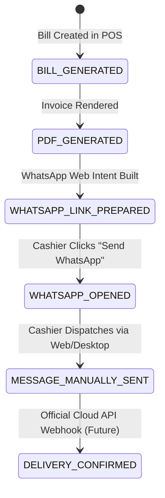

# THE STATION STORIES – Technical Architecture Specification

## 1. Architectural Overview

**THE STATION STORIES** system is engineered as a **Modular Monolith** designed for high reliability, strict financial safety, low operational complexity, and optimal counter performance. It comprises a decoupled **Spring Boot 3.3.x REST API** backend (Java 21) and a high-performance **React 18 + Vite Single Page Application (SPA)** frontend, communicating over secure JSON REST endpoints and backed by a **MySQL 8** relational database (`the_station_stories`).

```
                      +------------------------------------------+
                      |       Counter Laptop / Client Browser    |
                      |   React 18 + Vite + Tailwind CSS SPA    |
                      +--------------------+---------------------+
                                           |
                                  HTTPS / JSON REST
                                           |
                      +--------------------v---------------------+
                      |           Spring Boot 3.3 Backend        |
                      |           Modular Monolith (Java 21)     |
                      |                                          |
                      |  [Security & JWT]    [Rate Limiter]     |
                      |  [CORS Whitelist]    [Exception Advice] |
                      |                                          |
                      |  +------------------------------------+  |
                      |  | Core Functional Modules:           |  |
                      |  |  * Auth & RBAC (Admin, Cashier)    |  |
                      |  |  * Food Menu & Categories          |  |
                      |  |  * Customer CRM & Lookup           |  |
                      |  |  * POS Billing & Sequence Engine   |  |
                      |  |  * Financial Reports & Analytics   |  |
                      |  |  * Restaurant Settings & Tax Policy|  |
                      |  |  * Gallery & Asset Management      |  |
                      |  |  * WhatsApp & Invoice Delivery     |  |
                      |  |  * Audit Logging Service           |  |
                      |  +------------------------------------+  |
                      |                                          |
                      |      Spring Data JPA / HikariCP Pool     |
                      +--------------------+---------------------+
                                           |
                                     JDBC Connection
                                           |
                      +--------------------v---------------------+
                      |       MySQL 8: the_station_stories       |
                      |      Managed via Flyway Migrations       |
                      +------------------------------------------+
```

---

## 2. Technology Stack & Decision Rationale

### Frontend
- **Framework**: React 18 + Vite 5 (Fast HMR, lightweight bundle output, native ES modules).
- **Language**: JavaScript (ES2023+).
- **Styling**: Tailwind CSS 3.4 (Utility-first, responsive layouts, high-contrast dark/light accents matching restaurant ambiance).
- **Routing**: React Router DOM 6.x (Nested layouts, protected route guards for `/admin` and `/pos`).
- **HTTP Client**: Axios with centralized request/response interceptors (Bearer token injection, 401 token refresh).
- **Icons**: Lucide React (Tree-shakeable SVG icon set).
- **Receipt & Invoice Generation**:
  - Direct CSS `@media print` thermal styling (58mm and 80mm POS receipt roll standards).
  - Client-side PDF generation (`jspdf` + `html2canvas`) and public invoice rendering view.
- **State Management**: React Context API + Custom Hooks (`AuthContext`, `CartContext`, `LanguageContext`).

### Backend
- **Platform**: Java 21 bytecode release targeting, running on verified Java 26.0.1 runtime (macOS ARM64).
- **Framework**: Spring Boot 3.3.5 (Spring Framework 6.1.14, Jakarta EE 10).
- **Security**: Spring Security 6 + JJWT 0.12.x (Stateless Bearer JWT authentication, BCrypt password hashing).
- **Rate Limiting**: In-memory token bucket rate limiter (5 attempts per minute per IP on login endpoints).
- **Persistence**: Spring Data JPA + Hibernate 6.5.x.
- **Database Migrations**: Flyway 10.10.0 (Immutable version-controlled schema scripts).
- **Connection Pool**: HikariCP (High-throughput, low-latency connection management).
- **Data Validation**: Hibernate Validator / `jakarta.validation` annotations on all incoming DTOs.
- **API Documentation**: SpringDoc OpenAPI 3.0 (`/api-docs` and `/swagger-ui.html`).
- **Build Tool**: Apache Maven 3.9+.

### Database
- **Engine**: MySQL 9.5.0 (`the_station_stories`).
- **Character Set**: `utf8mb4` with `utf8mb4_unicode_ci` collation (supporting English, Hindi Devnagari script, and emojis).
- **Storage Engine**: InnoDB (ACID transactions, foreign key integrity, row-level locking for billing sequences).

---

## 3. UI/UX Design System Preparation

The visual theme for **THE STATION STORIES** takes direct inspiration from the restaurant's authentic architecture, vintage locomotive heritage, and modern lighting with the officially approved brand color palette:

```
+-------------------------------------------------------------------------------+
|                       THE STATION STORIES DESIGN SYSTEM                       |
+-------------------------------------------------------------------------------+
| Primary Surface / Light Bg | Warm Ivory        | #F7F1E8                      |
| Primary Brand & Contrast   | Royal Plum        | #45213F                      |
| Accent & Luxury Gold       | Champagne Gold    | #C5A16B                      |
| Dark Background Surface    | Deep Charcoal     | #1A181B / #121013            |
| Text Primary (on Light)    | Deep Charcoal     | #231F20                      |
| Text Secondary (on Light)  | Soft Slate / Plum | #5A4A57                      |
| Typography - Heading       | Playfair Display / Cormorant Garamond            |
| Typography - Body          | Inter / Plus Jakarta Sans                        |
+-------------------------------------------------------------------------------+
```

- **Brand Ambiance Harmony**: The Royal Plum (`#45213F`) and Champagne Gold (`#C5A16B`) mirror the authentic interior luxury seating, neon cove lighting, and vintage brass locomotive accents.
- **Authentic Photography Centrality**: Authentic images from `referance-assets/` are showcased prominently in the Hero, About Us, Ambience Highlights, and Photo Gallery.
- **Micro-interactions**: Subtle, purposeful transitions powered by GSAP, Motion, and Embla Carousel where appropriate.

---

## 4. Billing & Financial Data Safety Architecture

### 1. Authoritative Backend Calculations
The frontend shopping cart provides real-time preview totals for cashier convenience, but **all financial calculations are authoritatively recomputed on the backend**:
- Line Item Subtotal = `unit_price * quantity`
- Order Subtotal = `SUM(Line Item Subtotals)`
- Discount Amount = calculated based on validated discount type (`FLAT` or `PERCENTAGE`)
- Tax Computation = executed strictly based on dynamic `restaurant_settings` (**0.00% when disabled**)
- Grand Total = `ROUND(Order Subtotal - Discount Amount + Total Tax)`

### 2. Thread-Safe Concurrent Bill Number Generation
To prevent duplicate bill serials or number collisions during concurrent billing on counter terminals:
- A dedicated sequence table `bill_number_sequences` tracks daily sequences.
- During bill creation, the backend obtains a row-level lock via `SELECT current_sequence FROM bill_number_sequences WHERE sequence_date = CURRENT_DATE() FOR UPDATE`.
- Generates a guaranteed collision-free serial in format: `TSS-YYYYMMDD-XXXX` (e.g., `TSS-20261112-0001`).

### 3. Immutability & Anti-Cascading Deletion Rules
- **No Hard Deletes**: Finalized bills cannot be permanently deleted. The service layer strictly rejects delete operations on bills with a `BusinessException("Finalized bills cannot be permanently deleted")`.
- **Foreign Key Restriction**: In `bill_items`, the foreign key relationship to `bills` enforces `ON DELETE RESTRICT`. Under no circumstance will bill items be deleted.
- **Historical Price Snapshot**: Each `bill_items` record freezes `item_name`, `unit_price`, and `subtotal` at the exact moment of transaction. Subsequent edits to dish prices in `menu_items` will **never** alter historical invoices.

### 4. Auditable Cancellation & Refund Workflow
- A bill can only be cancelled by an authorized user (`ROLE_ADMIN` or authorized supervisor).
- When a bill is cancelled:
  1. `payment_status` is transitioned to `CANCELLED` or `REFUNDED`.
  2. `cancellation_reason`, `cancelled_by`, and `cancelled_at` are permanently recorded on the bill.
  3. An entry is automatically inserted into `audit_logs`.
  4. If linked to a registered customer, customer lifetime statistics (`visit_count` and `total_spent`) are adjusted accordingly.

### 5. Walk-in Anonymous Customer Handling
- Cashiers are **never** required to force phone numbers or personal details from customers.
- If a customer chooses not to provide a phone number:
  - `customer_id` is set to `NULL`.
  - `customer_name_snapshot` defaults to `'Walk-in Customer'`.
- If a 10-digit mobile number is provided:
  - The system performs a deduplicated lookup in `customers`.
  - Links the existing customer record (or creates a single new record if first-time).
  - Updates lifetime visit counts and total spend.

---

## 5. Thermal Receipt Printer Architecture

The restaurant counter utilizes a laptop connected to a USB thermal receipt printer (exact hardware make/model to be confirmed). The printing architecture is bifurcated into two separate capabilities:

```
                      +------------------------------------------+
                      |         Counter POS Interface            |
                      +--------------------+---------------------+
                                           |
                 +-------------------------+-------------------------+
                 |                                                   |
      [Mode A: Initial Release]                           [Mode B: Direct Print Bridge]
    Browser-Based Printing                              Local Hardware Bridge / Agent
                 |                                                   |
        window.print()                                    Raw ESC/POS Stream / USB
                 |                                                   |
      @media print CSS Styles                              Local Socket / WebUSB / Spooler
    (58mm / 80mm Layout Switch)                                      |
                 |                                                   |
                 +------------------------->+<-----------------------+
                                            |
                                 +----------v-----------+
                                 |  USB Thermal Printer |
                                 |  (58mm / 80mm Roll)  |
                                 +----------------------+
```

### Capability A: Browser-Based Printing (Initial Implementation)
- **Zero-Driver Requirement**: Works out of the box on Chrome, Edge, and Firefox without requiring proprietary native drivers.
- **Layout Standards**:
  - **80mm Mode**: 48 characters/line standard width.
  - **58mm Mode**: 32 characters/line compact roll width.
- **Styling Architecture**:
  - Uses CSS `@media print` with explicit `page-break-inside: avoid`.
  - Strips all screen elements (navbars, buttons, sidebars).
  - High-contrast black-and-white monospaced rendering.
  - Header: **THE STATION STORIES**, Address placeholder, Phone placeholder.
  - Meta: Bill Number (`TSS-YYYYMMDD-XXXX`), Date & Time, Cashier Name, Table/Cabin Ref.
  - Body: Item Name, Qty, Unit Price, Line Total.
  - Totals: Subtotal, Discount (if applied), Grand Total, Payment Mode (Cash / UPI).
  - GST Note: **Tax lines (CGST/SGST) are completely hidden unless `gst_enabled` is active**.
  - Footer: "Thank you for visiting The Station Stories!", Customer Support contact.

### Capability B: Direct USB Printing (Extensible Architecture)
- Eliminates the browser print dialog for instant one-touch printing.
- Since ordinary browser JavaScript cannot directly send raw byte commands to arbitrary USB endpoints due to browser security sandbox constraints:
  - The architecture includes a `ThermalPrintService` interface.
  - When the exact printer model is confirmed by the owner, a lightweight local print bridge (Node.js/Go local daemon or WebUSB API adapter) can be activated without altering the core POS billing logic.

---

## 6. WhatsApp Bill Delivery & Secure Public Access

### 1. Delivery State Machine
The system strictly distinguishes between URL generation and actual delivery:



- **Rule**: Generating the WhatsApp URL only transitions status to `WHATSAPP_LINK_PREPARED`. The system will **never** falsely mark a bill as delivered simply because a link was created.
- **Manual Fallback**: Cashier can click "Copy Bill Text", "Copy Invoice Link", or "Open WhatsApp Web" at any time.

### 2. Secure Public Invoice Link
- Customer bills must **never** be exposed through predictable sequential IDs like `/bill/view/101`.
- Every bill is assigned a cryptographically secure random UUID v4 (`invoice_uuid`, 128-bit entropy).
- Public bill URL format: `https://<domain>/bill/view/<uuid>`
- Prevents enumeration, scraping, or unauthorized access to other customers' purchases.

---

## 7. Security Architecture

1. **Password Security**:
   - BCrypt hashing with workload factor 12.
2. **Stateless JWT Authentication**:
   - Access Token lifespan: 8 hours.
   - Cryptographically signed with 256-bit secret key read from environment variable `JWT_SECRET`.
3. **Role-Based Access Control (RBAC)**:
   - `ROLE_ADMIN`: Access to `/api/v1/admin/**`, `/api/v1/pos/**`, and `/api/v1/public/**`.
   - `ROLE_CASHIER`: Restricted strictly to `/api/v1/pos/**` and `/api/v1/public/**`. Blocked from modifying menu prices, changing tax settings, or accessing managerial reports.
4. **Login Rate Limiting**:
   - In-memory token bucket rate limiting on `POST /api/v1/auth/login` (maximum 5 failed attempts per minute per IP) to prevent brute-force attacks.
5. **CORS Security**:
   - Strict origin whitelist (`http://localhost:5173` in development, production domain in production). Wildcards (`*`) are strictly prohibited when credentials are enabled.
6. **Input Validation**:
   - All incoming DTOs validated via Jakarta Bean Validation (`@NotBlank`, `@Size`, `@Pattern`, `@PositiveOrZero`).
7. **Secret Management**:
   - All production secrets (database credentials, JWT signing key) are injected via environment variables. Zero credentials are hardcoded or committed to version control.
8. **Admin Account Setup**:
   - Initial administrative account is established via Flyway migration with a temporary secret that must be changed on initial startup, or initialized via a command-line setup runner. Public self-registration for admin accounts is completely disabled.

---

## 8. GST & Tax Engine Specification

> [!IMPORTANT]
> GST registration status is currently unconfirmed by the restaurant owner.
> 1. Tax calculation is **strictly disabled by default** (`gst_enabled = false`).
> 2. Tax rate defaults to **0.00%**.
> 3. No GSTIN or tax lines appear on customer bills, thermal receipts, or POS displays until confirmed.
> 4. When the owner confirms registration and enters GSTIN and tax rates in Admin Settings, the tax engine dynamically computes and itemizes CGST and SGST without requiring code changes.

```
Total Calculation Logic:
  Item_Subtotal = SUM(unit_price * quantity)
  Discounted_Subtotal = Item_Subtotal - discount_amount
  IF (restaurant_settings.gst_enabled == true) {
      CGST = Discounted_Subtotal * (restaurant_settings.cgst_rate / 100)
      SGST = Discounted_Subtotal * (restaurant_settings.sgst_rate / 100)
      Total_Tax = CGST + SGST
  } ELSE {
      CGST = 0.00
      SGST = 0.00
      Total_Tax = 0.00
  }
  Grand_Total = ROUND(Discounted_Subtotal + Total_Tax)
```

---

## 9. Extensibility Hooks (Postponed Features)

The initial release focuses on core operations while cleanly accommodating future modules:

| Postponed Feature | Extensibility Hook |
|---|---|
| **Private Cabin Booking** | The restaurant has three private cabins. In Phase 0–6, cabins are handled via `cabin_table_ref` on POS bills (`Cabin 1`, `Cabin 2`, `Cabin 3`). Online booking entity `CabinReservation` can be added in Phase 8 without refactoring existing billing. |
| **Online Food Ordering** | `OrderType` enum supports `ONLINE_ORDER` alongside `DINE_IN` and `TAKEAWAY`. |
| **Payment Gateway Integration** | `PaymentProcessingStrategy` interface allows plug-and-play addition of Razorpay, Cashfree, or Paytm. |
| **Kitchen Order Ticket (KOT)** | `bill_items.item_status` enum (`ORDERED`, `PREPARING`, `SERVED`) enables future kitchen display terminal route `/kitchen`. |
| **Inventory Management** | `MenuItem` entity supports an optional `recipe_id` foreign key for future ingredient depletion. |

---

## 10. Cross-Platform Strategy & Future Windows Offline POS Architecture

### 1. Separation of Public Website & Private POS
The public customer-facing website and the private POS management system are strictly separated:
- **Public Website (Phase 3)**: Independent customer-facing web application optimized for desktop, tablet, and mobile browsers (Digital Menu, QR Menu `/qr-menu`, Ambiance Gallery, Restaurant Story, Public Invoice Viewer `/bill/view/:uuid`).
- **Private POS & Admin (Future / Separate Phases)**: Dedicated operations application with role guards, cashier fast-billing workflows, and manager controls.

### 2. Future POS Windows Local Deployment
In future phases, the POS billing application will run on a dedicated counter computer running Windows:
- **Local Database**: Embedded/Local MySQL instance (`localhost:3306`) ensuring 100% offline billing capability without relying on internet connectivity.
- **Offline Reliability**: Peak rush-hour billing, thermal receipt printing, and sequence generation operate seamlessly regardless of ISP downtime.

### 3. Backup Architecture (Encrypted External & Cloud)
To guarantee zero data loss:
- **Encrypted Local Backups**: Automated daily encrypted database dumps saved to local external drives / USB storage.
- **Encrypted Cloud Backups**: Periodic secure synchronization of encrypted snapshots to off-site cloud storage whenever internet is active.

### 4. Cross-Platform Codebase Integrity
- Avoid any macOS-specific assumptions in scripts, paths, or code (use standard forward slashes, standard environment variable injection, platform-neutral Java 21 / Node.js standard APIs).
- The same application codebase builds and runs identically on macOS (development), Linux (cloud servers), and Windows (restaurant counter hardware).

